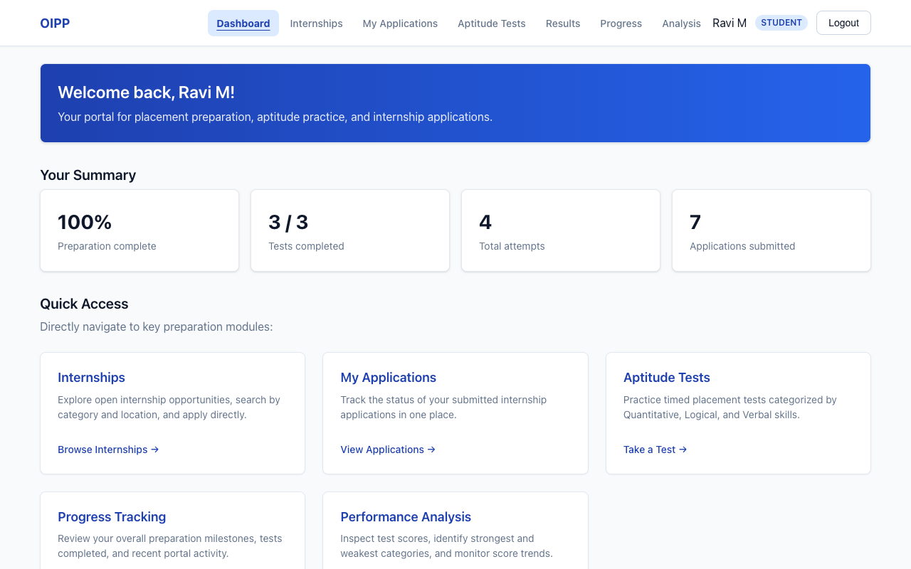
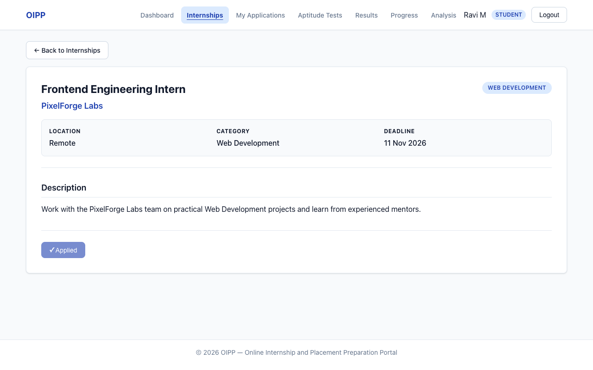
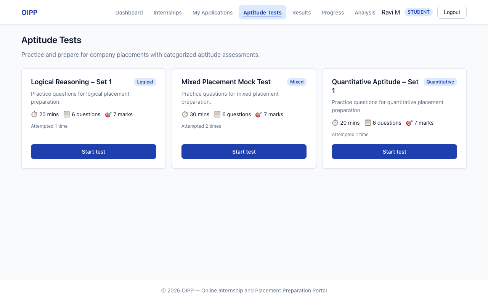
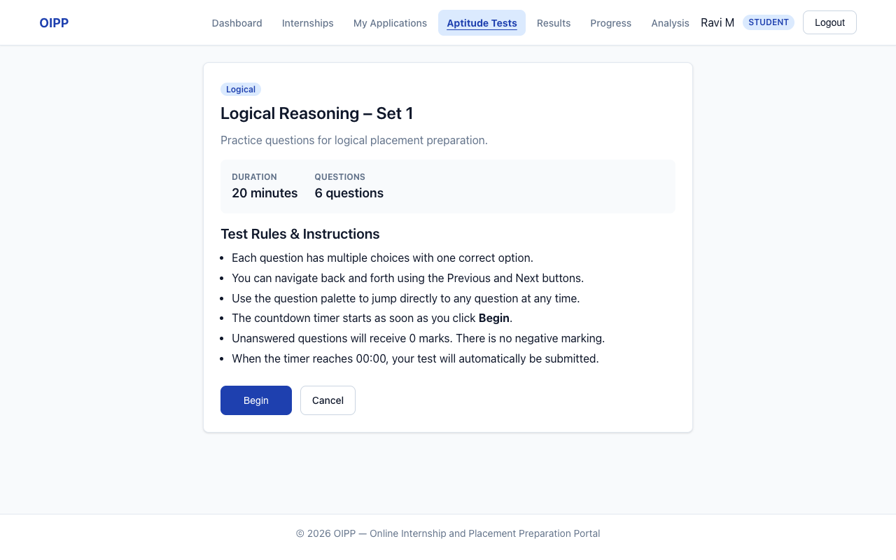
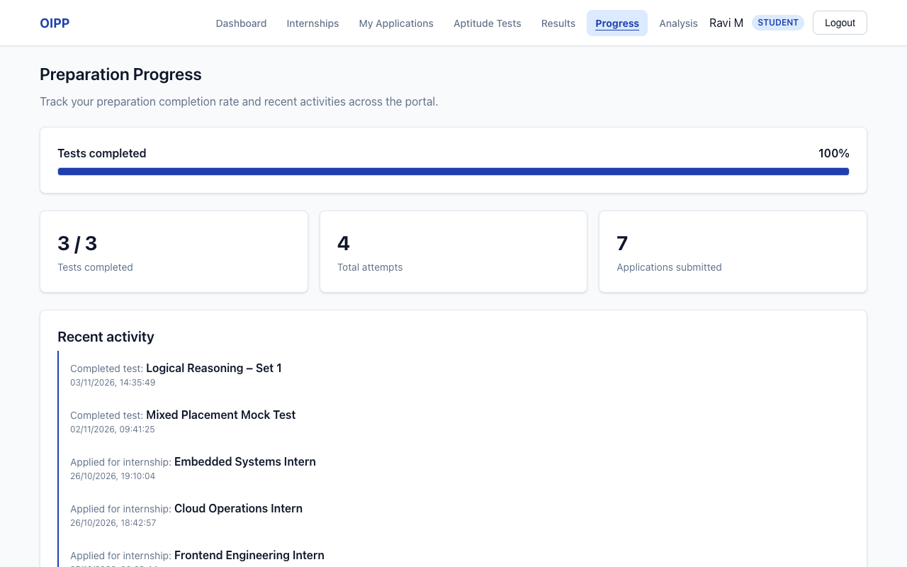
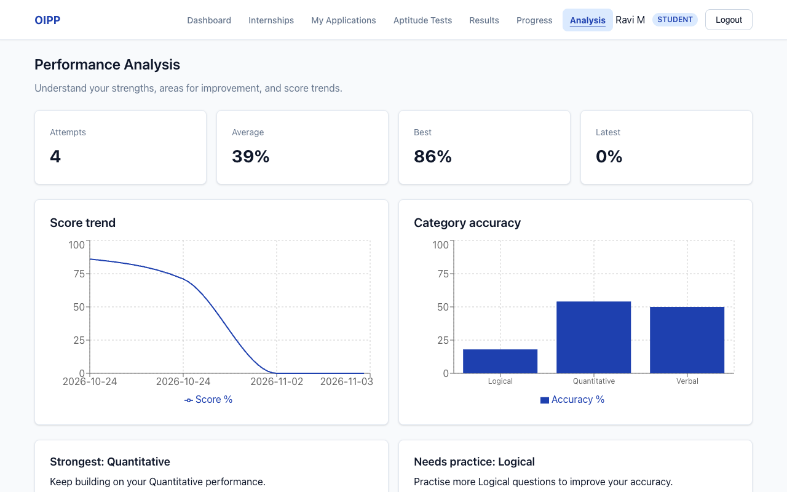
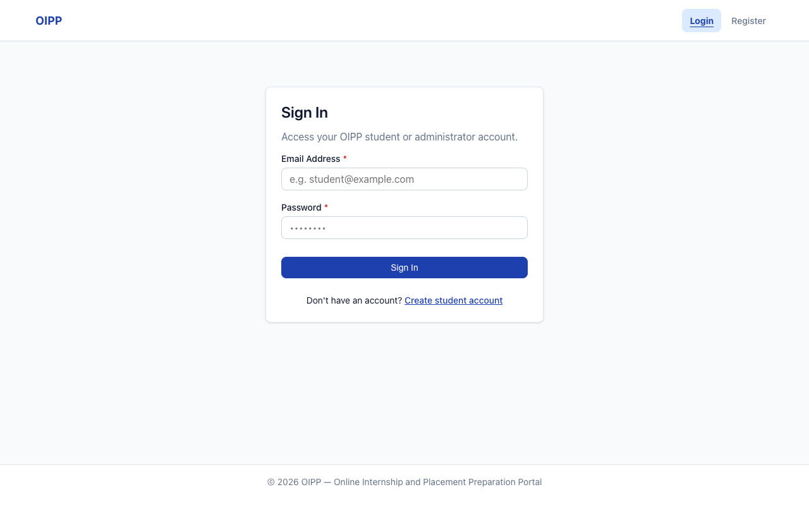
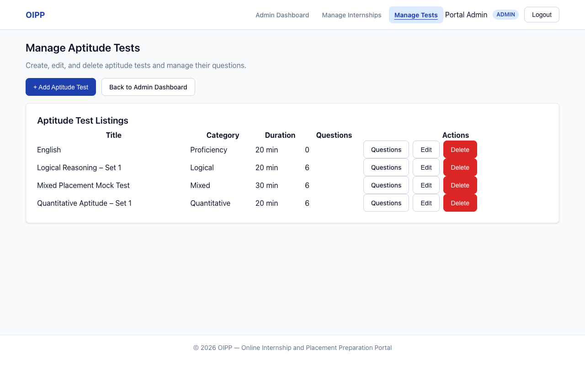

# Online Internship and Placement Preparation Portal (OIPP)

[](https://github.com/Online-Internship-Placement-Portal-OIPP/online-internship-placement-portal/actions/workflows/ci.yml)

A web-based platform that gives students a single place to discover internship opportunities, apply for them, take aptitude tests, track preparation progress, and view performance analysis. Administrators manage internship listings, aptitude tests, and questions through a dedicated admin interface.

> **Actors:** Student · Administrator
> **No recruiter/company actor. No Python service** — analysis runs inside Node.js (ADR-07).

**Release:** `v1.0` — Sprint 2 final (development frozen after this release).

---

## Team

| Name | GitHub username | Role | Stories | Modules |
|---|---|---|---|---|
| Namitha R | [@namithar18](https://github.com/namithar18) | Member 1 · SRS & Requirements Lead · Repository Owner | S0-01, S0-05, S1-01, S1-02, S2-05, S2-06, S2-07 | M1 Authentication, M5 Progress Tracking, client shell, student dashboard (NFR-05), documentation |
| Manu Kudukundi | [@kmanu28](https://github.com/kmanu28) | Member 2 · Test Plan Lead | S0-03, S1-05, S1-06, S2-08, S2-09 | M3 Application Management, M6 Performance Analysis, test infrastructure, NFR verification |
| Kavana P G | [@kavanapg276-glitch](https://github.com/kavanapg276-glitch) | Member 3 · Architecture & Design Lead | S0-02, S1-03, S1-04, S2-01, S2-02 | Server scaffold and models, M2 Internship Management (read), M4 Aptitude Test Management (student side) |
| Koushik | [@Koushik504](https://github.com/Koushik504) | Member 4 · UML, Security & Integration Lead | S0-04, S1-07, S1-08, S2-03, S2-04 | CI and security middleware, M7 Admin Management (internships, tests, questions), security validation |

---

## Features by requirement

| Requirement | Feature | Page | Endpoint |
|---|---|---|---|
| FR-01 | Student registration | `/register` | `POST /api/register` |
| FR-02 | Login with JWT session and role-based redirect | `/login` | `POST /api/login` |
| FR-03 | View internship listings | `/internships` | `GET /api/internships` |
| FR-04 | Search and filter internships | `/internships` | `GET /api/internships`, `GET /api/internships/meta` |
| FR-05 | Internship details | `/internships/:id` | `GET /api/internships/:id` |
| FR-06 | Apply for an internship (no duplicates) | `/internships/:id` | `POST /api/applications` |
| FR-07 | View my applications | `/applications` | `GET /api/applications` |
| FR-08 | View available aptitude tests | `/tests` | `GET /api/tests` |
| FR-09 | Take a timed test and submit answers | `/tests/:id/attempt` | `GET /api/tests/:id`, `POST /api/tests/:id/submit` |
| FR-10 | Server-side scoring | `/tests/:id/attempt` | `POST /api/tests/:id/submit` |
| FR-11 | View results and category breakdown | `/results`, `/results/:id` | `GET /api/results`, `GET /api/results/:id` |
| FR-12 | Record preparation activity | (automatic on apply / submit) | `POST /api/applications`, `POST /api/tests/:id/submit` |
| FR-13 | View preparation progress | `/progress`, `/dashboard` | `GET /api/progress` |
| FR-14 | Performance analysis with charts | `/analysis` | `GET /api/analysis` |
| FR-15 | Admin manages internships | `/admin/internships` | `POST/PUT/DELETE /api/admin/internships[/:id]` |
| FR-16 | Admin manages aptitude tests and questions | `/admin/tests`, `/admin/tests/:id` | `GET/POST/PUT/DELETE /api/admin/tests[/:id]`, `POST /api/admin/tests/:id/questions`, `PUT/DELETE /api/admin/questions/:qid` |
| NFR-05 | Dashboard links to every student module | `/dashboard` | `GET /api/progress` |

The full API contract (request and response shapes, error codes) is in [`CLAUDE.md` §6–§7](CLAUDE.md#6-api-contract-sad-43--base-path-api-json-only).

---

## Screenshots

| Student dashboard | Internship details |
|---|---|
|  |  |

| Aptitude tests | Test instructions |
|---|---|
|  |  |

| Preparation progress | Performance analysis |
|---|---|
|  |  |

| Login | Admin: manage tests |
|---|---|
|  |  |

---

## Architecture

The system is a **three-layer modular monolith** (SAD §3.5). Full diagrams and design decisions are in the [Software Architecture & Design Specification v1.2](Deliverable-1/,,Software_Architecture_and_Design_Specification_v1.2.docx).

- **Presentation layer:** React 18 single-page application built with Vite 5. It only talks to the API, never to the database.
- **Application / API layer:** Node.js 22 LTS + Express 4.21.x, organised into modules M1–M7. Each module follows routes → controller → service → model. All business rules, scoring and performance analysis run here (no separate Python service, ADR-07).
- **Data layer:** MongoDB 7 accessed only through Mongoose 8.x.

| Module | Name | Requirements | Code |
|---|---|---|---|
| M1 | Authentication | FR-01, FR-02, SR-01–SR-03, SR-05 | `server/src/modules/auth/`, `server/src/middleware/auth.js` |
| M2 | Internship Management | FR-03, FR-04, FR-05 | `server/src/modules/internships/` |
| M3 | Application Management | FR-06, FR-07, NFR-04, SR-04 | `server/src/modules/applications/` |
| M4 | Aptitude Test Management | FR-08–FR-11 | `server/src/modules/aptitude/` |
| M5 | Progress Tracking | FR-12, FR-13 | `server/src/modules/progress/` |
| M6 | Performance Analysis | FR-14 | `server/src/modules/analysis/` |
| M7 | Admin Management | FR-15, FR-16, NFR-03 | `server/src/modules/internships/adminInternships.*`, `server/src/modules/aptitude/adminAptitude.*` (see D-10, D-15) |

Submitted Deliverable-1 documents: [SRS v1.0](Deliverable-1/SRS_Template_OIPP.docx) · [Test Plan v2](Deliverable-1/Test_Plan_V2.docx) · [SAD v1.2](Deliverable-1/,,Software_Architecture_and_Design_Specification_v1.2.docx)

---

## Technology stack

| Layer | Choice |
|---|---|
| Runtime | Node.js **22 LTS** (`.nvmrc` → `22`) |
| Backend | Express **4.21.x**, CommonJS (`require`) |
| Database / ODM | MongoDB **7**, Mongoose **8.x** |
| Auth | `jsonwebtoken` 9.x · `bcryptjs` 2.4.x (10 rounds) |
| Validation | `zod` 3.x |
| Security | `helmet` 8.x · `cors` 2.x · `express-rate-limit` 7.x |
| Frontend | React **18** · Vite **5** · `react-router-dom` 6 · `axios` 1.x |
| Charts | `recharts` 2.x (analysis page only) |
| Styling | Plain CSS — design tokens in `client/src/styles/global.css` |
| Server tests | Jest 29.x · Supertest 7.x · `mongodb-memory-server` 10.x |
| Client tests | Vitest 2.x · `@testing-library/react` · `jsdom` |
| CI | GitHub Actions (`.github/workflows/ci.yml`) |

---

## Getting started

### Prerequisites

- Node.js 22 LTS — with [nvm](https://github.com/nvm-sh/nvm): `nvm use` (reads `.nvmrc`)
- MongoDB 7 Community Server running locally **or** an Atlas free-tier connection string
- Git

### 1 — Clone and install dependencies

```bash
git clone https://github.com/Online-Internship-Placement-Portal-OIPP/online-internship-placement-portal.git
cd online-internship-placement-portal

npm install                 # root (concurrently scripts)
npm install --prefix server
npm install --prefix client
```

### 2 — Configure environment variables

```bash
cp server/.env.example server/.env
```

Edit `server/.env`:

```
NODE_ENV=development
PORT=5000
MONGODB_URI=mongodb://127.0.0.1:27017/oipp
JWT_SECRET=replace-with-a-long-random-string
JWT_EXPIRES_IN=3600
CLIENT_ORIGIN=http://localhost:5173
```

`MONGODB_URI` and `JWT_SECRET` are required — the server refuses to start without them. Never commit `server/.env`.

### 3 — Start MongoDB and seed the database

Make sure MongoDB is running, then from the repo root:

```bash
npm run seed
```

The seed **clears the development database** and creates the demo data below. Admin accounts can only be created this way — registration always creates a student.

### Seeded accounts

| Role | Email | Password |
|---|---|---|
| Administrator | `admin@oipp.test` | `Admin@12345` |
| Student | `asha@oipp.test` | `Student@123` |
| Student | `ravi@oipp.test` | `Student@123` |
| Student | `meera@oipp.test` | `Student@123` |

Ravi has two sample internship applications and two aptitude-test results, so the progress and performance-analysis screens have data straight away. Asha and Meera start empty, which shows the empty states.

### 4 — Run the application

```bash
npm run dev
```

This starts the API on port 5000 and the client on port 5173. Open [http://localhost:5173](http://localhost:5173).

### 5 — Run the tests

```bash
npm test                    # server (Jest) then client (Vitest), from the repo root

npm test --prefix server    # server only
npm test --prefix client    # client only
npm run build --prefix client
```

Server tests use an in-memory MongoDB, so no database needs to be running. CI runs both suites and the client build on every pull request to `main`.

### 6 — Run the performance test (NFR-01)

With the seeded server running (`npm run dev`):

```bash
npm run perf --prefix server
```

It sends 250 requests and checks that at least 95% finish within 3 seconds. Results are written to [`docs/perf/nfr-01-results.json`](docs/perf/nfr-01-results.json). Each run makes 11 login requests and logins are rate-limited to 20 per 15 minutes, so wait 15 minutes (or restart the server) between runs.

---

## Project documents

| Document | Description |
|---|---|
| [`CLAUDE.md`](CLAUDE.md) / [`AGENTS.md`](AGENTS.md) | Master build specification followed by every contributor and AI assistant |
| [`SOURCE_OF_TRUTH.md`](SOURCE_OF_TRUTH.md) | Requirements, API, architecture and decisions baseline |
| [`CONTRIBUTING.md`](CONTRIBUTING.md) | Branching, commit, PR and sprint rules |
| [`docs/DEVIATIONS.md`](docs/DEVIATIONS.md) | Every difference from the SRS / SAD / Test Plan, with reasons |
| [`docs/TEST_EXECUTION_REPORT.md`](docs/TEST_EXECUTION_REPORT.md) | Actual result for every Test Plan case (TC ids) |
| [`docs/SECURITY_VALIDATION.md`](docs/SECURITY_VALIDATION.md) | Security validation results (Test Plan §5.1, SR-01–SR-05) |
| [`docs/api/OIPP.postman_collection.json`](docs/api/OIPP.postman_collection.json) | Postman collection for the API |
| [`docs/sprint-videos/`](docs/sprint-videos/) | Sprint demo videos |

---

## Repository layout (summary)

```
/
├── CLAUDE.md / AGENTS.md    # build contract
├── SOURCE_OF_TRUTH.md       # requirements & design baseline
├── CONTRIBUTING.md          # team workflow
├── Deliverable-1/           # submitted SRS, Test Plan and SAD (not modified)
├── server/                  # Node.js + Express API (modules M1–M7)
│   ├── src/
│   ├── scripts/             # seed.js, perf-test.js
│   └── tests/
├── client/                  # React 18 + Vite SPA
│   └── src/
└── docs/
    ├── DEVIATIONS.md
    ├── SECURITY_VALIDATION.md
    ├── TEST_EXECUTION_REPORT.md
    ├── api/
    ├── perf/
    ├── screenshots/
    └── sprint-videos/
```

See [`CLAUDE.md` §3](CLAUDE.md#3-repository-layout) for the full tree.

---

## Sprint schedule

| Milestone | Dates |
|---|---|
| Dry Run | 12–16 October 2026 |
| Sprint 1 | 19–23 October 2026 |
| Sprint 2 | 26–30 October 2026 |
| Feature freeze | `v1.0` tag on `main` |

---

## AI assistance

As permitted by the project brief, the team used AI coding assistants (such as Claude Code and GitHub Copilot) during development. Every assistant worked from [`CLAUDE.md`](CLAUDE.md), which is derived from our submitted SRS, Test Plan and SAD, so the code follows the agreed requirements, API contract and error catalogue. Every change went through a pull request opened by the story owner, was reviewed by a team member, and had to pass CI before it was merged. Any difference from the submitted documents is recorded in [`docs/DEVIATIONS.md`](docs/DEVIATIONS.md).

---

## Contributing

See [`CONTRIBUTING.md`](CONTRIBUTING.md) for branching strategy, commit message format, PR review rules and the definition of done.
